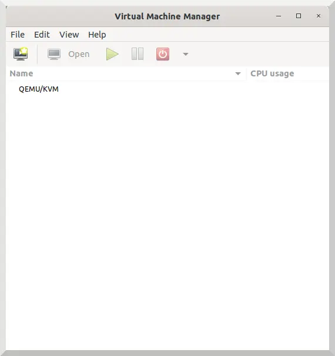

# 01 - Installation de KVM

## Objectif

Créer, sous **Linux**, un environnement professionnel composé de plusieurs **machines virtuelles (VM)**, se rapprochant d'une infrastructure réseau d'entreprise, afin de pratiquer l'**administration système et réseau**.

## Pourquoi KVM ?

Initialement, je m'étais orienté vers **VirtualBox** pour sa simplicité de prise en main. Cependant, après plusieurs recherches, j'ai constaté que **KVM** était plus adapté aux objectifs du projet : une solution **performante, intégrée à Linux** et utilisée dans les environnements professionnels.

## Installation

### Environnement utilisé

- **Système hôte :** Debian
- **Hyperviseur :** KVM
- **Émulation et virtualisation :** QEMU
- **Gestion des machines virtuelles :** libvirt
- **Interface graphique :** Virt-Manager

### 1. Accès administrateur

Passage en mode **root** pour disposer des droits nécessaires à l'installation :

```bash
su -
```

### 2. Installation des outils

Mise à jour de la liste des paquets :

```bash
apt update
```

Installation des composants nécessaires à la virtualisation :

```bash
apt install qemu-kvm libvirt-daemon-system libvirt-clients virt-manager
```

### 3. Vérification

Vérification du fonctionnement du service libvirt :

```bash
systemctl status libvirtd
```

Lancement de **Virt-Manager** depuis la session utilisateur graphique :

```bash
virt-manager
```

### 4. Résultat

Environnement de virtualisation opérationnel sous Debian, prêt pour la création et la configuration des machines virtuelles.


