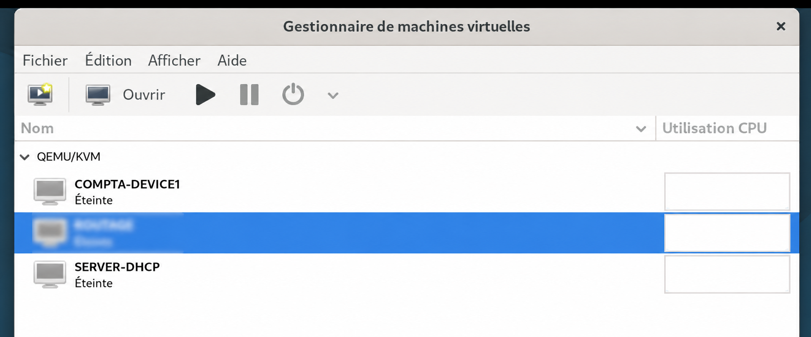

# 02 - Création des VM

## Objectif

Créer une première infrastructure réseau composée de **deux VM** : un serveur DHCP et un poste client, connectés au **même réseau virtuel**.

Cette configuration permet de tester le fonctionnement du DHCP avant de faire évoluer l’infrastructure.

## Configuration de la machine hôte

- **Système :** Debian
- **Processeur :** Intel Core i5-1135G7
- **RAM :** 8 Go
- **Stockage :** 225 Go

## Création des VM

Création de deux VM sous **KVM**, à l’aide de **Virt-Manager**.

### 1. Serveur DHCP

- **Nom :** SERVER-DHCP
- **Système d’exploitation :** Microsoft Windows Server 2022
- **RAM :** 2 Go
- **CPU :** 2 vCPU
- **Stockage :** 40 Go

### 2. Poste client

- **Nom :** COMPTA-DEVICE1
- **Système d’exploitation :** Microsoft Windows 11
- **RAM :** 4 Go
- **CPU :** 2 vCPU
- **Stockage :** 40 Go

### Choix des ressources

L’allocation des ressources a été définie en fonction des besoins des systèmes et des limites matérielles de l’hôte :

- **RAM :** 2 Go pour Windows Server 2022, dédié au DHCP, et 4 Go pour Windows 11 afin de respecter ses prérequis minimaux.
- **CPU :** 2 vCPU par VM, suffisants pour cette première phase du projet.
- **Stockage :** 40 Go par VM, pour accueillir les systèmes d’exploitation et les fichiers nécessaires au projet.

## Résultat

Deux VM ont été créées sous KVM :

- **SERVER-DHCP :** serveur Windows Server 2022
- **COMPTA-DEVICE1 :** poste client Windows 11

La capture suivante présente les VM utilisées pour cette étape dans **Virt-Manager**.

## Évolution prévue

Après validation de cette première infrastructure :

- ajout d’un **routeur**
- création de **nouveaux réseaux**
- mise en place d’un **relais DHCP**
- extension de l’infrastructure à plusieurs sous-réseaux

---

**Ressources :** Connaissances personnelles en matériel informatique (RAM, CPU, stockage), tutoriels YouTube et utilisation de l’intelligence artificielle pour approfondir les notions techniques et accompagner la configuration.
