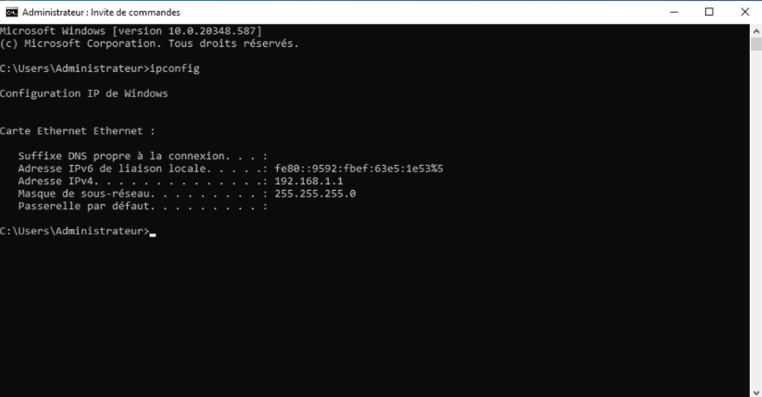
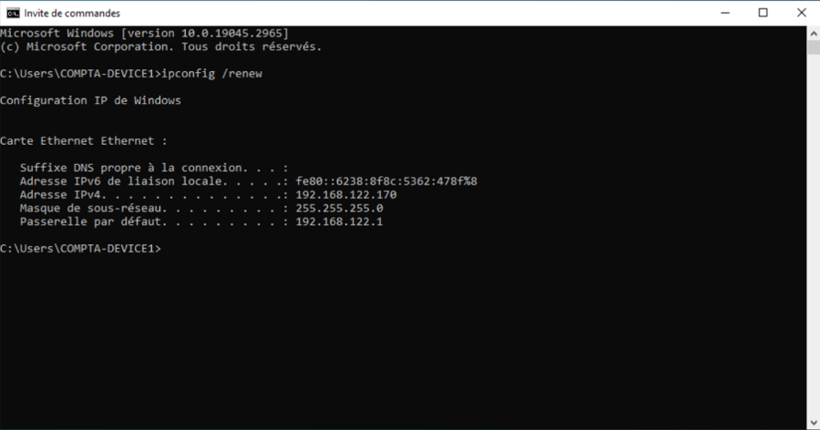
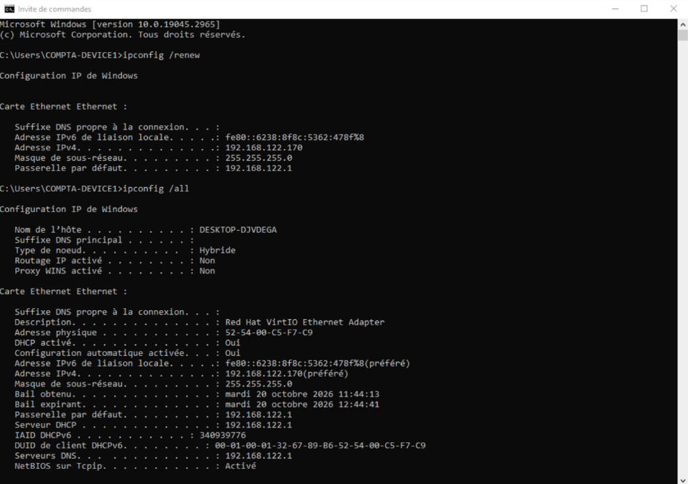

# 03 - Installation et configuration du DHCP

## Objectif

Installer et configurer un **serveur DHCP sous Windows Server 2022** afin de distribuer automatiquement des adresses IP aux machines clientes du réseau `192.168.1.0/24`.

## 1. Installation des rôles

Depuis le **Gestionnaire de serveur** de Windows Server 2022 :

1. Sélection de **Ajouter des rôles et fonctionnalités**.
2. Installation du rôle **Serveur DHCP**.
3. Installation du rôle **Serveur DNS**.

Le rôle DHCP permet l'attribution automatique des adresses IP. Le rôle DNS a été installé en complément pour la résolution de noms.

## 2. Configuration de l'étendue DHCP

Création d'une nouvelle étendue depuis la console DHCP.

| Paramètre | Configuration |
|-----------|---------------|
| Réseau | 192.168.1.0/24 |
| Adresse de début | 192.168.1.2 |
| Adresse de fin | 192.168.1.4 |
| Masque de sous-réseau | 255.255.255.0 |
| Durée du bail | 8 jours |
| Passerelle | Non configurée |

La plage `192.168.1.2` à `192.168.1.4` permet de distribuer automatiquement **3 adresses IPv4**.

La durée du bail de **8 jours** correspond à la valeur proposée par défaut lors de la configuration.

## 3. Configuration de l'adresse IP fixe

Après la création de l'étendue, j'ai constaté que je n'avais pas encore attribué d'adresse IP fixe au serveur.

J'ai donc procédé à sa configuration :

1. Ouverture de **Exécuter** avec `Win + R`.
2. Saisie de la commande :

```cmd
ncpa.cpl
```

3. Ouverture des propriétés de la carte réseau.
4. Sélection de **Protocole Internet version 4 (TCP/IPv4)**.
5. Configuration manuelle de l'adresse IP.

| Paramètre | Configuration |
|-----------|---------------|
| Adresse IPv4 | 192.168.1.1 |
| Masque de sous-réseau | 255.255.255.0 |
| Passerelle | Non configurée |
| DNS préféré | 192.168.1.1 |

L'adresse `192.168.1.1` a été choisie pour placer le serveur dans le même sous-réseau que les futurs clients, tout en restant **en dehors de la plage DHCP**.

## 4. Vérification de la configuration

Depuis **SERVER-DHCP**, ouverture de l'invite de commandes et exécution de :

```cmd
ipconfig
```

Cette commande m'a permis de vérifier que le serveur utilisait bien l'adresse IPv4 fixe `192.168.1.1` et le masque de sous-réseau `255.255.255.0`.



J'ai également vérifié que l'étendue DHCP était activée depuis la console DHCP.

## 5. Premiers tests et difficultés

Au départ, je pensais qu'il suffisait d'installer et de configurer le serveur DHCP pour que **COMPTA-DEVICE1** récupère automatiquement une adresse IP depuis celui-ci.

J'ai donc effectué un premier test depuis le client pour vérifier que cette attribution fonctionnait.

La configuration attendue était la suivante :

| Paramètre | Configuration attendue |
|-----------|------------------------|
| Adresse IPv4 | 192.168.1.2 à 192.168.1.4 |
| Masque de sous-réseau | 255.255.255.0 |
| Serveur DHCP | 192.168.1.1 |
| Passerelle | Non configurée |

### Premier renouvellement DHCP

Depuis l'invite de commandes du client, j'ai exécuté :

```cmd
ipconfig /renew
```

**Résultat :** le client obtient bien une adresse IP, mais celle-ci ne correspond pas à la plage configurée sur mon serveur.

L'adresse attribuée est `192.168.122.170`, avec une passerelle `192.168.122.1`.



### Identification du serveur DHCP

Pour vérifier d'où provenait cette configuration, j'ai utilisé :

```cmd
ipconfig /all
```

La commande affiche notamment les informations suivantes :

| Paramètre | Résultat obtenu |
|-----------|-----------------|
| DHCP activé | Oui |
| Adresse IPv4 | 192.168.122.170 |
| Masque de sous-réseau | 255.255.255.0 |
| Serveur DHCP | 192.168.122.1 |
| Passerelle | 192.168.122.1 |



Le client reçoit donc bien une adresse par DHCP, **mais pas depuis mon serveur Windows (`192.168.1.1`)**.

### Recherche du problème

Je ne comprenais pas pourquoi le client recevait une adresse IP différente de celle prévue, alors que mon serveur DHCP était configuré.

Après m'être renseigné sur ce problème, j'ai découvert que **KVM/libvirt créait par défaut un réseau virtuel disposant de son propre service DHCP**.

Ce service pouvait donc attribuer des adresses IP aux machines virtuelles, indépendamment du serveur DHCP que j'avais installé sous Windows Server.

J'ai alors compris que **la configuration du serveur DHCP ne suffisait pas à elle seule** : il fallait également configurer le réseau virtuel pour que mes deux VM puissent utiliser le DHCP de Windows Server.

J'ai donc décidé de créer un **réseau virtuel isolé**, sans DHCP fourni par libvirt.

Cette configuration sera présentée dans l'étape suivante.

## 6. Résultat de cette étape

- Rôles **DHCP et DNS** installés sur Windows Server 2022.
- Adresse IPv4 fixe `192.168.1.1/24` configurée.
- Étendue DHCP `192.168.1.2` à `192.168.1.4` créée et activée.
- Configuration IP du serveur vérifiée.
- Premier test DHCP effectué depuis le client.
- Identification d'un autre serveur DHCP (`192.168.122.1`) attribuant les adresses IP.

Le serveur Windows est configuré, mais **l'attribution DHCP depuis SERVER-DHCP n'est pas encore validée**.

La prochaine étape consistera à créer un réseau isolé sous KVM/libvirt pour que le client puisse obtenir sa configuration IP depuis le serveur Windows.

---

<sub>**Ressources :** Connaissances personnelles en adressage IP et DHCP, tutoriels YouTube et utilisation de l'intelligence artificielle pour accompagner la configuration et le diagnostic des problèmes rencontrés.</sub>
