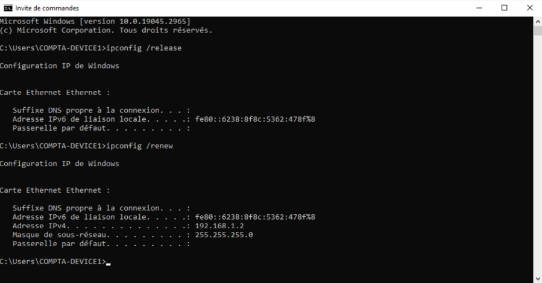
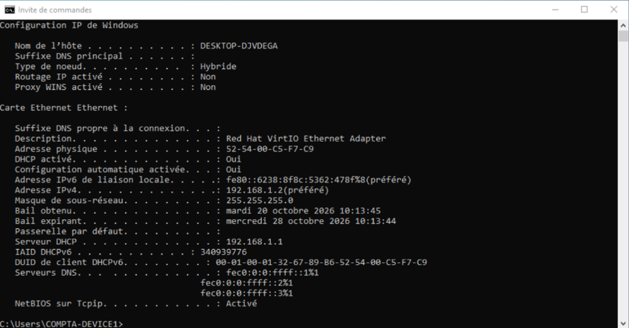
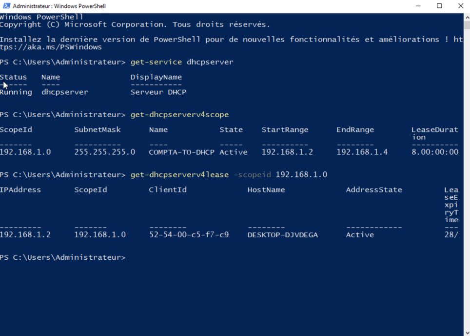
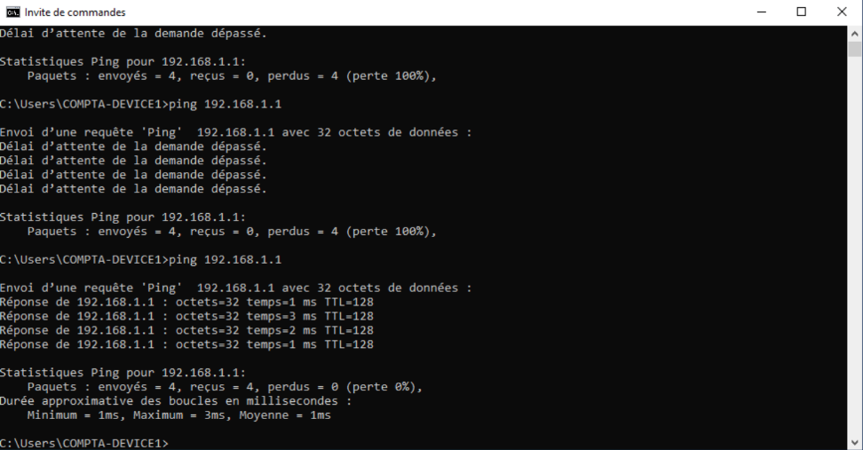

# 05 - Tests et validation de l'infrastructure

## Objectif

Vérifier le bon fonctionnement du **serveur DHCP** et la communication entre les deux machines virtuelles :

- **SERVER-DHCP :** Windows Server 2022
- **COMPTA-DEVICE1 :** Windows 11

## 1. Test et vérification du DHCP côté client

Une fois les deux VM installées et le réseau configuré, lancement des premiers tests sur **COMPTA-DEVICE1**.

Dans le terminal Windows :

```cmd
ipconfig /release
ipconfig /renew
```

- **`ipconfig /release` :** libère le bail DHCP actuel.
- **`ipconfig /renew` :** demande une nouvelle configuration IP au serveur DHCP.

L'objectif était de forcer une nouvelle attribution afin de ne pas se fier à une adresse IP déjà obtenue auparavant.

**Résultat :** renouvellement effectué avec succès.



### Vérification de l'adresse attribuée

Pour rappel, **COMPTA-DEVICE1** doit recevoir une configuration IP correspondant à la configuration suivante : 

| Paramètre | Configuration attendue |
|-----------|------------------------|
| DHCP activé | Oui |
| Adresse IPv4 | 192.168.1.2 à 192.168.1.4 |
| Masque de sous-réseau | 255.255.255.0 (/24) |
| Serveur DHCP | 192.168.1.1 |
| Passerelle | Non configurée |

Pour vérifier ces informations, exécution de la commande :

```cmd
ipconfig /all
```

**Résultat :** la configuration obtenue correspond à celle attendue. Le poste client reçoit bien une adresse appartenant à l'étendue DHCP, distribuée par `SERVER-DHCP`.



## 2. Vérification côté serveur

Afin de contrôler également le fonctionnement du DHCP depuis **SERVER-DHCP**, utilisation de PowerShell.

### État du service

```powershell
Get-Service DHCPServer
```

Permet de vérifier que le service DHCP est en cours d'exécution.

### Configuration de l'étendue

```powershell
Get-DhcpServerv4Scope
```

Permet de consulter la plage d'adresses configurée et son état.

### Baux DHCP

```powershell
Get-DhcpServerv4Lease -ScopeId 192.168.1.0
```

Permet de consulter les adresses attribuées aux machines clientes.



## 3. Test de connectivité

Depuis **COMPTA-DEVICE1**, lancement d'un test de communication avec le serveur :

```cmd
ping 192.168.1.1
```

**Résultat initial : échec du ping**, alors que le DHCP fonctionnait correctement.

### Problème rencontré

Face à cet échec, j'ai commencé par vérifier les éléments que je connaissais :

- L'adresse IP attribuée au client.
- L'adresse IP fixe du serveur.
- Le fonctionnement du serveur DHCP.
- La configuration réseau du serveur avec `ipconfig`.

Toutes ces vérifications étant correctes, j'ai envisagé que le problème pouvait provenir d'un élément que je ne connaissais pas encore.

### Recherche et résolution

Après des recherches et avec l'aide de l'IA, j'ai découvert que le **pare-feu Windows Server** pouvait bloquer les requêtes ICMPv4, utilisées par la commande `ping`.

Ouverture de la configuration avancée du pare-feu sur **SERVER-DHCP** :

```cmd
wf.msc
```

Puis :

1. Accès aux **règles de trafic entrant**.
2. Recherche de la règle **Demande d'écho - Trafic entrant ICMPv4**.
3. Activation de cette règle.

### Nouveau test

Depuis **COMPTA-DEVICE1** :

```cmd
ping 192.168.1.1
```

**Résultat : ping réussi.**

Le problème provenait du filtrage ICMPv4 par le pare-feu Windows Server.



## 4. Résultat final

La première infrastructure réseau est **fonctionnelle**.

| Vérification | Résultat |
|--------------|----------|
| Attribution DHCP | ✅ Validé |
| Renouvellement du bail DHCP | ✅ Validé |
| Configuration IP du client | ✅ Validé |
| Service DHCP Windows | ✅ Validé |
| Communication client / serveur | ✅ Validé |
| Résolution du blocage ICMPv4 | ✅ Validé |

## 5. Ce que j'ai appris

Cette étape m'a permis de découvrir une nouvelle dimension du diagnostic réseau : **un service peut fonctionner correctement alors qu'un autre type de communication est bloqué**.

J'ai notamment appris à différencier :

- **DHCP (UDP)** : attribution automatique de la configuration réseau.
- **ICMP** : protocole utilisé notamment par `ping`.
- **Pare-feu Windows** : filtrage des communications selon les règles configurées.

Cette difficulté m'a également amené à m'interroger sur les bonnes pratiques de sécurité. Une étape dédiée à la **sécurisation de l'infrastructure** sera ajoutée à la fin du projet.

---

<sub>**Ressources :** Connaissances personnelles en réseau, tutoriels YouTube et utilisation de l'intelligence artificielle pour approfondir les notions techniques et accompagner la résolution des problèmes.</sub>
