# 06 - Évolution de l'infrastructure : OPNsense et relais DHCP

## Objectif

Après avoir validé le fonctionnement de mon premier serveur DHCP avec un poste client Windows 11, j'ai souhaité faire évoluer mon infrastructure.

Je me suis posé une nouvelle question : **comment ajouter un deuxième poste client sur un réseau différent, tout en conservant un seul serveur DHCP ?**

Après quelques recherches, je me suis orienté vers la mise en place d'un **routeur** et d'un **relais DHCP**.

L'objectif est de faire évoluer le réseau initial vers une infrastructure composée de trois sous-réseaux :

- Un réseau pour le serveur DHCP.
- Un réseau pour les postes Comptabilité.
- Un réseau pour les postes Commercial.

Cette étape permet également de découvrir la configuration d'un premier routeur et d'adapter les services déjà installés dans les chapitres précédents.

## 1. Nouvelle architecture réseau

Dans la première version du projet, **SERVER-DHCP** et **COMPTA-DEVICE1** étaient connectés au même réseau virtuel isolé.

Le serveur Windows distribuait des adresses IP sur le réseau `192.168.1.0/24`.

Pour faire évoluer cette infrastructure, j'ai retenu l'organisation suivante :

| Réseau | Sous-réseau | Utilisation |
|--------|-------------|-------------|
| Serveur | 192.168.1.0/24 | Serveur DHCP et routeur |
| Comptabilité | 192.168.2.0/24 | Postes Comptabilité |
| Commercial | 192.168.3.0/24 | Postes Commercial |

Le serveur conserve son adresse IPv4 fixe `192.168.1.1`.

Les postes clients seront désormais placés sur deux réseaux distincts, reliés au réseau du serveur par un routeur.

Pour les tests, j'ai choisi de réutiliser **COMPTA-DEVICE1** en le connectant successivement aux réseaux Comptabilité et Commercial, en raison des ressources limitées de mon PC hôte.

*Schéma de la nouvelle architecture à ajouter : SERVER-DHCP, OPNsense et les réseaux Comptabilité et Commercial.*

## 2. Création de la VM OPNsense

Pour relier les différents réseaux, j'ai choisi **OPNsense**, une solution gratuite et open source disposant d'une interface web et des fonctionnalités nécessaires au projet, notamment le relais DHCP.

Depuis **Virt-Manager**, création d'une nouvelle VM à partir de l'image d'installation d'OPNsense.

### Configuration de la VM

| Paramètre | Configuration |
|-----------|---------------|
| Nom | ROUTAGE |
| Système | OPNsense |
| RAM | 2 Go |
| CPU | 2 vCPU |
| Stockage | 20 Go |

Installation d'OPNsense depuis son image ISO, puis démarrage de la VM pour procéder à sa configuration initiale.

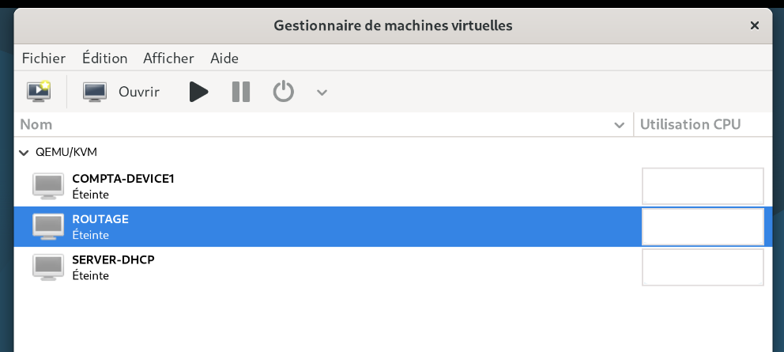

## 3. Configuration initiale d'OPNsense

Après l'installation d'OPNsense, configuration de l'interface **LAN** depuis la console de la VM.

### 1. Attribution de l'adresse IPv4

Depuis le menu principal de la console :

1. Sélection de l'option **2 - Set interface IP address**.
2. Sélection de l'interface **LAN**.
3. Choix d'une configuration IPv4 statique, sans DHCP.
4. Attribution de l'adresse IPv4 `192.168.1.254`.
5. Configuration du préfixe réseau `/24`, correspondant au masque `255.255.255.0`.
6. Validation de la configuration.

| Paramètre | Configuration |
|-----------|---------------|
| Interface | LAN |
| Adresse IPv4 | 192.168.1.254 |
| Masque | 255.255.255.0 |
| Type | Statique |

L'adresse `192.168.1.254` a été choisie pour placer le routeur sur le même sous-réseau que **SERVER-DHCP (`192.168.1.1`)**, sans conflit d'adressage.

### 2. Vérification

Après validation, vérification de l'adresse LAN affichée dans la console OPNsense.

Une fois la VM raccordée au réseau Serveur, cette adresse permet d'accéder à l'administration web depuis Windows Server :

`https://192.168.1.254`

La configuration des interfaces Comptabilité et Commercial sera effectuée après l'ajout des cartes réseau supplémentaires.

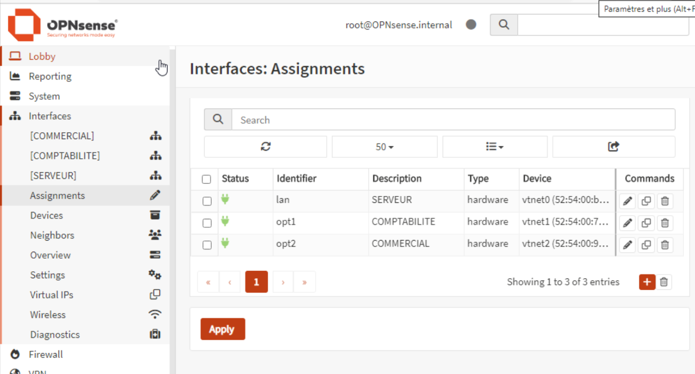

## 4. Création des réseaux virtuels sous KVM

Dans la première partie du projet, j'avais créé un réseau isolé pour permettre à SERVER-DHCP et COMPTA-DEVICE1 de communiquer directement.

La nouvelle architecture nécessite désormais trois réseaux virtuels distincts.

Depuis **Virt-Manager**, création et configuration des réseaux nécessaires :

| Réseau | Utilisation |
|--------|-------------|
| Serveur | Communication entre SERVER-DHCP et ROUTAGE |
| COMPTABILITE | Réseau des postes Comptabilité |
| COMMERCIAL | Réseau des postes Commercial |

### 1. Configuration du DHCP de libvirt

Désactivation du service DHCP intégré à libvirt sur les réseaux clients.

Lors des premiers tests du projet, j'avais identifié que ce service pouvait distribuer des adresses IP à la place de Windows Server.

Cette configuration permet donc de conserver **SERVER-DHCP** comme serveur chargé de l'attribution des adresses.

La capture suivante montre la configuration du réseau isolé initial, **SERVER-TO-COMPTA**, avec le service DHCP de libvirt désactivé.

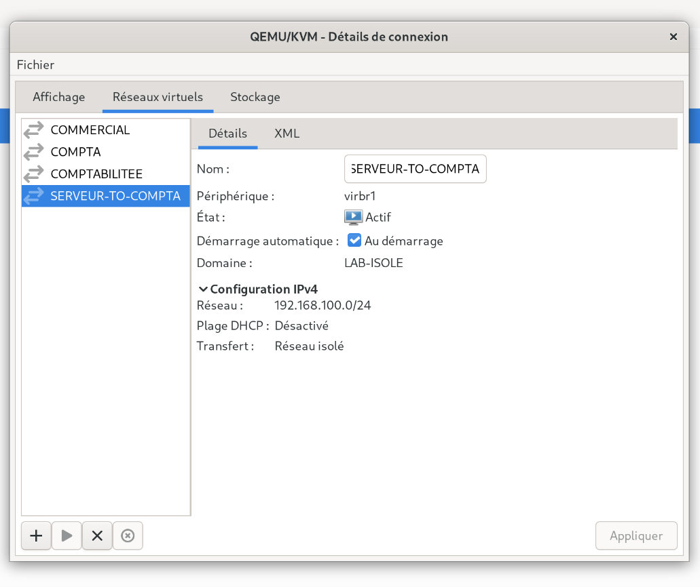

### 2. Ajout des cartes réseau au routeur

Pour raccorder OPNsense aux trois réseaux, ajout de **deux cartes réseau supplémentaires** à la VM ROUTAGE.

La VM dispose désormais de trois interfaces réseau :

| Interface OPNsense | Réseau associé |
|--------------------|---------------|
| LAN (`vtnet0`) | Serveur |
| OPT1 (`vtnet1`) | COMPTABILITE |
| OPT2 (`vtnet2`) | COMMERCIAL |

Chaque carte est associée à son réseau virtuel depuis les paramètres matériels de la VM dans Virt-Manager.

L'association des interfaces est vérifiée dans OPNsense après le raccordement des cartes.

## 5. Raccordement des VM et configuration des interfaces

Après la création des réseaux, raccordement des VM aux réseaux correspondants.

### 1. Association des VM

| VM ou interface | Réseau virtuel |
|-----------------|---------------|
| SERVER-DHCP | Serveur |
| ROUTAGE - LAN | Serveur |
| ROUTAGE - OPT1 | COMPTABILITE |
| ROUTAGE - OPT2 | COMMERCIAL |
| COMPTA-DEVICE1 | COMPTABILITE |

Le poste Windows 11, initialement connecté au réseau du serveur, a été déplacé sur **COMPTABILITE** pour les premiers tests.

### 2. Configuration des interfaces OPNsense

Depuis le navigateur de SERVER-DHCP, accès à l'interface web d'OPNsense :

`https://192.168.1.254`

Depuis le menu **Interfaces**, configuration des deux nouvelles interfaces :

1. Sélection de **OPT1**, puis activation de l'interface.
2. Configuration en **Static IPv4** avec l'adresse `192.168.2.1/24`.
3. Enregistrement et application des modifications.
4. Sélection de **OPT2**, puis activation de l'interface.
5. Configuration en **Static IPv4** avec l'adresse `192.168.3.1/24`.
6. Enregistrement et application des modifications.

### Configuration finale

| Interface | Réseau | Adresse IPv4 | Masque |
|-----------|--------|--------------|--------|
| LAN | Serveur | 192.168.1.254 | 255.255.255.0 |
| OPT1 | Comptabilité | 192.168.2.1 | 255.255.255.0 |
| OPT2 | Commercial | 192.168.3.1 | 255.255.255.0 |

Ces adresses seront utilisées comme passerelles pour les machines des trois réseaux.

La configuration des interfaces est visible dans **Interfaces → Assignments**.

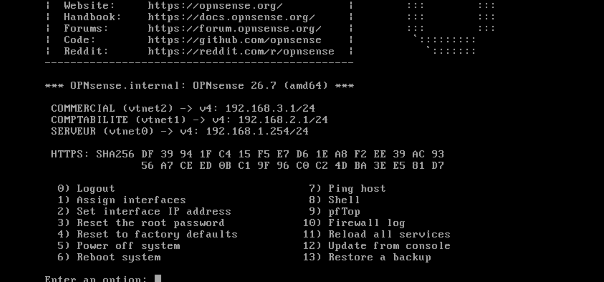

## 6. Adaptation du serveur DHCP Windows

La nouvelle infrastructure nécessite également d'adapter la configuration de **SERVER-DHCP**.

Dans les chapitres précédents, une seule étendue DHCP avait été créée sur le réseau `192.168.1.0/24`.

Elle permettait de distribuer les adresses `192.168.1.2` à `192.168.1.4` au poste client.

Avec la nouvelle architecture, ce réseau est réservé au serveur et au routeur. Les postes clients utiliseront désormais les réseaux Comptabilité et Commercial.

### 1. Modification de la configuration IP du serveur

Le serveur conserve son adresse fixe `192.168.1.1`, mais une passerelle a été ajoutée pour permettre les communications avec les autres sous-réseaux.

| Paramètre | Configuration |
|-----------|---------------|
| Adresse IPv4 | 192.168.1.1 |
| Masque | 255.255.255.0 |
| Passerelle | 192.168.1.254 |
| DNS préféré | 192.168.1.1 |

La passerelle `192.168.1.254` correspond à l'interface LAN d'OPNsense.

### 2. Adaptation de l'étendue initiale

L'étendue du réseau `192.168.1.0/24` n'est plus utilisée pour les postes des deux nouveaux réseaux.

Adaptation de ses options à la présence du routeur, notamment l'option **003 Routeur**, renseignée avec l'adresse `192.168.1.254`.

Les postes Comptabilité et Commercial disposeront chacun de leur propre étendue DHCP.

### 3. Création de l'étendue Comptabilité

Depuis la console DHCP de Windows Server, création d'une nouvelle étendue pour le réseau Comptabilité.

| Paramètre | Configuration |
|-----------|---------------|
| Réseau | 192.168.2.0/24 |
| Adresse de début | 192.168.2.2 |
| Adresse de fin | 192.168.2.4 |
| Masque | 255.255.255.0 |
| Passerelle - Option 003 | 192.168.2.1 |
| DNS - Option 006 | 192.168.1.1 |

Cette étendue permet de distribuer **3 adresses IPv4**.

La passerelle `192.168.2.1` correspond à l'interface OPT1 d'OPNsense.

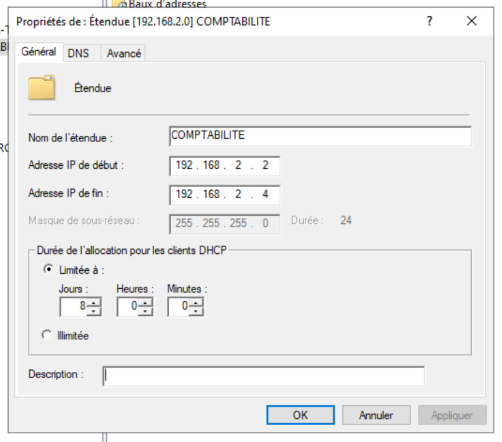

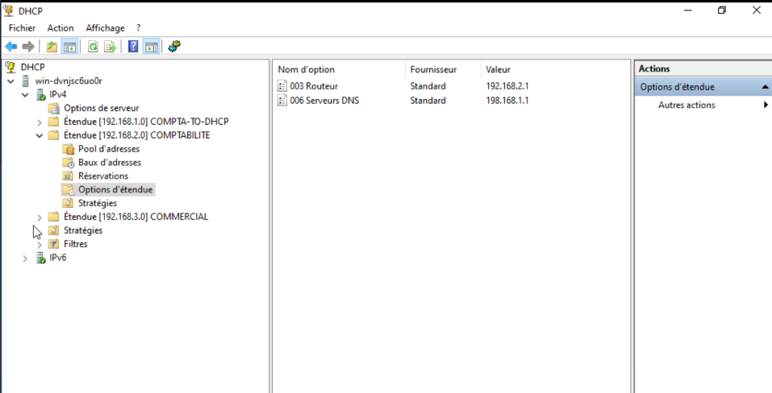

### 4. Création de l'étendue Commercial

Création d'une troisième étendue pour le réseau Commercial.

| Paramètre | Configuration |
|-----------|---------------|
| Réseau | 192.168.3.0/24 |
| Adresse de début | 192.168.3.2 |
| Adresse de fin | 192.168.3.4 |
| Masque | 255.255.255.0 |
| Passerelle - Option 003 | 192.168.3.1 |
| DNS - Option 006 | 192.168.1.1 |

Cette étendue permet également de distribuer **3 adresses IPv4**.

La passerelle `192.168.3.1` correspond à l'interface OPT2 d'OPNsense.

Les réseaux Comptabilité et Commercial utilisent le même serveur DNS, `192.168.1.1`, mais disposent chacun de leur propre passerelle.

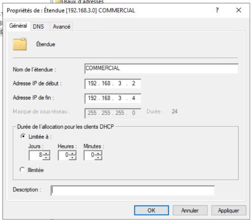

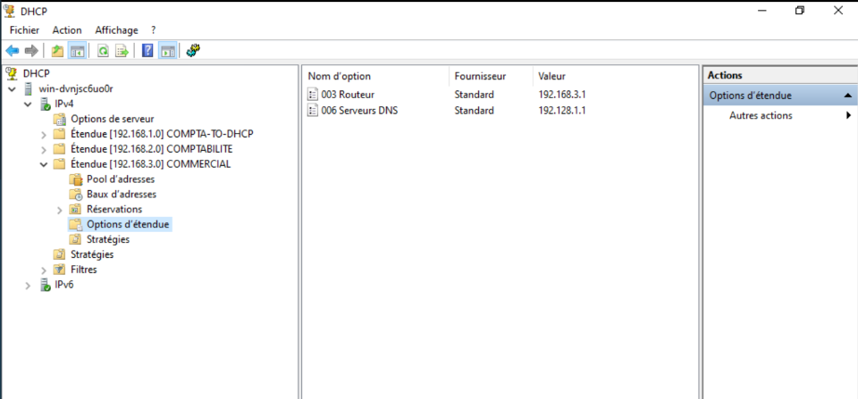

## 7. Configuration du relais DHCP

Le serveur DHCP Windows étant situé sur le réseau `192.168.1.0/24`, il fallait permettre aux postes Comptabilité et Commercial de lui transmettre leurs demandes DHCP.

Configuration du **relais DHCP** depuis l'interface web d'OPNsense.

### 1. Configuration de la destination

Depuis :

**Services → DHCRelay → Destinations**

Ajout de l'adresse du serveur DHCP Windows.

| Paramètre | Configuration |
|-----------|---------------|
| Destination | 192.168.1.1 |

### 2. Configuration des relais

Depuis :

**Services → DHCRelay → Relays**

Création des relais associés aux deux réseaux clients.

| Interface | Destination |
|-----------|-------------|
| COMPTABILITE (OPT1) | SERVER-DHCP - 192.168.1.1 |
| COMMERCIAL (OPT2) | SERVER-DHCP - 192.168.1.1 |

Les paramètres étaient renseignés, mais l'activation des relais avait été oubliée. Ce problème a été identifié lors des tests suivants.

La capture ci-dessous présente la configuration finale, après activation des relais.

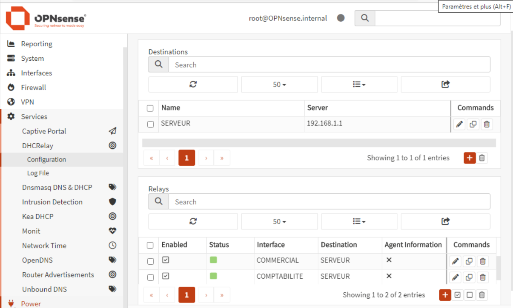

## 8. Premier test et difficultés

Une fois l'infrastructure configurée, premier test depuis **COMPTA-DEVICE1**, connecté au réseau Comptabilité.

La carte réseau Windows était configurée pour obtenir automatiquement une adresse IPv4.

### 1. Renouvellement DHCP

Depuis l'invite de commandes du client :

```cmd
ipconfig /release
ipconfig /renew
```

**Résultat : le poste ne reçoit pas d'adresse correspondant à l'étendue Comptabilité.**

Pour vérifier sa configuration :

```cmd
ipconfig /all
```

J'ai constaté que Windows utilisait une adresse IPv4 commençant par `169.254`.

### 2. Identification de l'adresse obtenue

Après quelques recherches, j'ai découvert qu'il s'agissait d'une adresse **APIPA**, attribuée automatiquement par Windows lorsqu'un poste configuré en DHCP ne parvient pas à obtenir une adresse depuis un serveur DHCP.

Le client ne recevait donc pas la configuration attendue depuis SERVER-DHCP.

J'ai décidé de reprendre les vérifications depuis les éléments de base de l'infrastructure.

*Capture facultative à ajouter : résultat du premier test montrant une adresse APIPA, si une capture a été conservée.*

## 9. Vérifications et résolution du problème

### 1. Vérification des réseaux virtuels

Depuis Virt-Manager, vérification des éléments suivants :

- Présence des réseaux isolés.
- Association des cartes réseau d'OPNsense.
- Raccordement de COMPTA-DEVICE1 à COMPTABILITE.
- Désactivation du DHCP de libvirt sur les réseaux clients.

L'objectif était de vérifier que les VM étaient correctement raccordées aux réseaux prévus.

### 2. Vérification du serveur DHCP

Depuis SERVER-DHCP, contrôle des paramètres suivants :

- Adresse IPv4 fixe et passerelle.
- Plages d'adresses des étendues.
- Masques de sous-réseau.
- Options 003 Routeur et 006 Serveurs DNS.
- Activation des étendues.

Les paramètres vérifiés correspondaient à la configuration prévue.

### 3. Vérification d'OPNsense

Contrôle des adresses IP des trois interfaces :

| Interface | Adresse IPv4 |
|-----------|--------------|
| LAN | 192.168.1.254/24 |
| COMPTABILITE | 192.168.2.1/24 |
| COMMERCIAL | 192.168.3.1/24 |

Vérification de la destination du relais DHCP (`192.168.1.1`) et des interfaces associées.

**C'est lors de cette dernière vérification que j'ai identifié le problème : les relais DHCP étaient correctement configurés, mais désactivés.**

### 4. Correction

Activation des relais DHCP Comptabilité et Commercial dans OPNsense, puis application des modifications.

Un nouveau test DHCP a ensuite été effectué depuis le client.

## 10. Tests et validation

### 1. Test sur le réseau Comptabilité

Après l'activation des relais DHCP, renouvellement de l'adresse IP depuis COMPTA-DEVICE1, toujours connecté à COMPTABILITE.

```cmd
ipconfig /release
ipconfig /renew
ipconfig /all
```

### Configuration attendue

| Paramètre | Valeur |
|-----------|--------|
| Adresse IPv4 | 192.168.2.2 à 192.168.2.4 |
| Masque | 255.255.255.0 |
| Passerelle | 192.168.2.1 |
| Serveur DHCP | 192.168.1.1 |
| DNS | 192.168.1.1 |

**Résultat : le client reçoit une adresse IPv4 correspondant à l'étendue Comptabilité.**

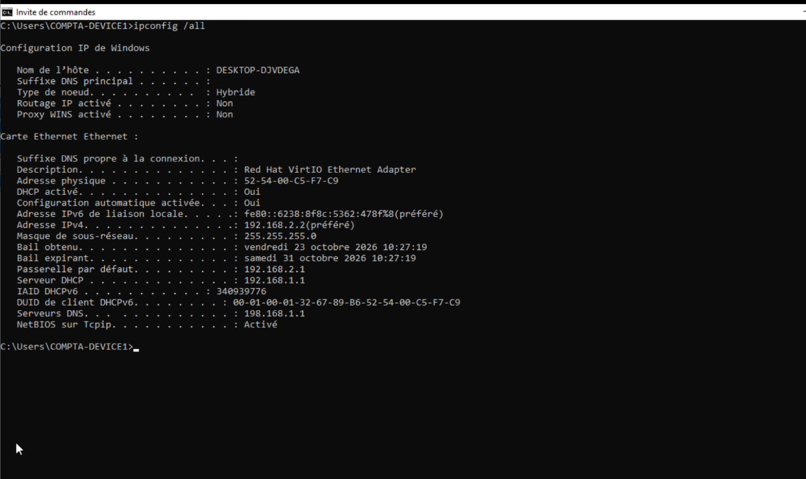

### 2. Test sur le réseau Commercial

Pour vérifier le fonctionnement de la deuxième étendue, utilisation de la même VM Windows 11.

Depuis Virt-Manager :

1. Arrêt de COMPTA-DEVICE1.
2. Ouverture des paramètres de sa carte réseau.
3. Modification du réseau virtuel de COMPTABILITE vers COMMERCIAL.
4. Redémarrage de Windows 11.

Le client conserve sa configuration IP automatique.

Vérification avec :

```cmd
ipconfig /all
```

### Configuration attendue

| Paramètre | Valeur |
|-----------|--------|
| Adresse IPv4 | 192.168.3.2 à 192.168.3.4 |
| Masque | 255.255.255.0 |
| Passerelle | 192.168.3.1 |
| Serveur DHCP | 192.168.1.1 |
| DNS | 192.168.1.1 |

**Résultat : le client reçoit une adresse IPv4 correspondant à l'étendue Commercial.**

Cette vérification confirme que le serveur DHCP Windows distribue correctement les adresses sur les deux réseaux, grâce au relais DHCP d'OPNsense.

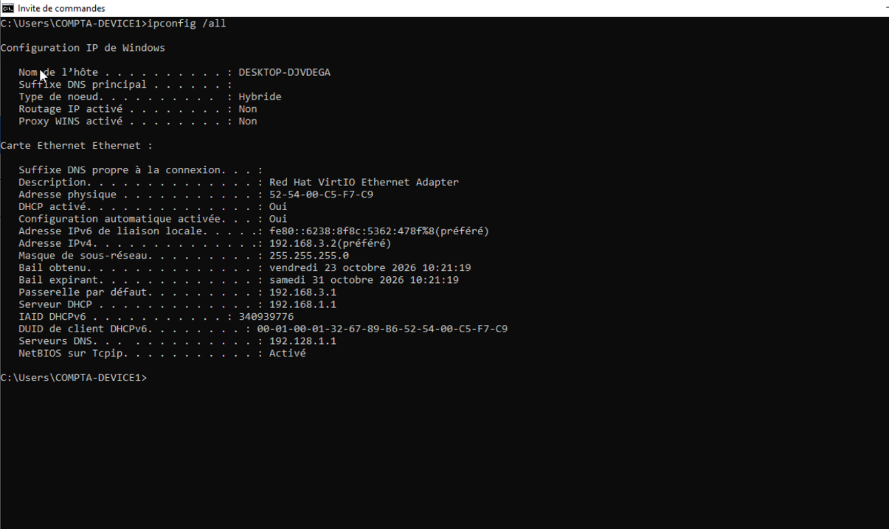

## 11. Résultat de cette étape

L'infrastructure initiale a été adaptée pour fonctionner avec trois sous-réseaux distincts.

- **SERVER-DHCP :** serveur DHCP Windows Server 2022, `192.168.1.1`.
- **ROUTAGE :** routeur OPNsense disposant de trois interfaces.
- **Comptabilité :** réseau `192.168.2.0/24`.
- **Commercial :** réseau `192.168.3.0/24`.
- **Relais DHCP :** transmission des demandes des réseaux clients vers SERVER-DHCP.

Les tests réalisés avec COMPTA-DEVICE1 confirment l'attribution automatique d'adresses IP sur Comptabilité et Commercial.

**L'objectif de cette évolution est atteint : le serveur DHCP Windows distribue désormais des adresses sur plusieurs sous-réseaux grâce au relais DHCP d'OPNsense.**

Le filtrage inter-réseaux et le renforcement des règles de pare-feu pourront être étudiés dans une évolution ultérieure.

## 12. Ce que j'ai appris

Cette étape m'a permis de découvrir et de mieux comprendre :

- La création et la configuration d'un premier routeur avec OPNsense.
- L'organisation de plusieurs réseaux virtuels isolés sous KVM.
- L'utilisation de plusieurs cartes réseau sur une même VM.
- La configuration des passerelles et des étendues DHCP pour plusieurs sous-réseaux.
- Le rôle du relais DHCP.
- La signification d'une adresse APIPA.
- L'importance de vérifier l'activation des services lors d'un diagnostic.

J'ai notamment retenu qu'une configuration pouvait être correcte sans pour autant fonctionner si le service correspondant n'était pas activé.

Cette évolution m'a également permis de comprendre comment **modifier une infrastructure déjà fonctionnelle** pour répondre à un nouveau besoin, plutôt que de repartir de zéro.

---

<sub>**Ressources :** Connaissances acquises lors des premières étapes du projet, documentation et tutoriels techniques, ainsi qu'utilisation de l'intelligence artificielle pour approfondir les notions de routage et de relais DHCP et accompagner la résolution du problème rencontré.</sub>
