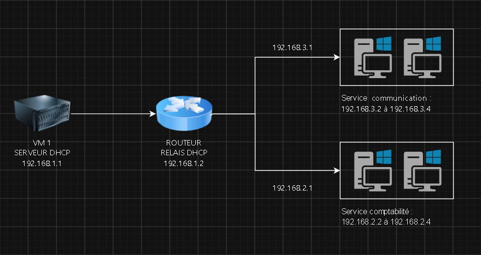

# Lab de virtualisation KVM : serveur DHCP et poste comptabilité

| Linux | Virtualisation (KVM) | Machines virtuelles | Réseau (IP, DHCP) |
|:---:|:---:|:---:|:---:|
| 🟦⬜⬜⬜ | 🟦⬜⬜⬜ | 🟦⬜⬜⬜ | 🟦🟦⬜⬜ |

Échelle : 🟦⬜⬜⬜ Découverte · 🟦🟦⬜⬜ Apprentissage · 🟦🟦🟦⬜ Pratique · 🟦🟦🟦🟦 Maîtrise

## Un projet de découverte 

Ce projet représente ma toute première expérience technique dans le domaine des systèmes et réseaux.

Ce que je connaissais avant :
- Linux : je connaissais le nom, mais je ne l'avais jamais utilisé.
- Installation d'un système : j'avais déjà installé Windows plusieurs
  fois depuis une clé USB, mais jamais Linux.
- Réseau (IP, DNS, DHCP, étendue..) : je connaissais ces termes de nom, grâce
  aux jeux vidéo, sans savoir concrètement comment ils fonctionnent.

Ce que je découvre avec ce projet :
- Linux, installé depuis une clé USB
- KVM et la virtualisation
- Les ISO et les VM
- Le fonctionnement concret d'un réseau (DHCP, adresses IP..)

J'apprends en m'appuyant sur des ressources en ligne, notamment la documentation disponible sur GitHub et Reddit, 
ainsi que des tutoriels sur YouTube.

## Objectif du projet
Installer Linux sur un PC depuis une clé USB, puis utiliser la
virtualisation (KVM) pour créer 4 machines virtuelles à partir de
différentes ISO (serveur, Windows...), et monter un petit réseau
d'entreprise.

| VM | Rôle | Réseau |
|:---|:---|:---|
| VM 1 | Serveur DHCP | 192.168.1.1 |
| VM 2 | Routeur (3 cartes réseau) | Relie les 3 réseaux entre eux |
| VM 3 | Poste comptabilité | 192.168.2.2 à 192.168.2.4 |
| VM 4 | Poste communication | 192.168.3.2 à 192.168.3.4 |

Le but : le serveur DHCP distribue les adresses IP aux postes de
comptabilité et de communication, qui sont sur des réseaux différents.
La VM routeur, reliée aux trois réseaux, fait circuler le trafic entre
eux et relaie les demandes DHCP vers le serveur.

## État du projet
*Dernière mise à jour : 19/10/2026*

- [ ] Installation de Linux sur le PC depuis une clé USB
- [ ] Installation de KVM
- [ ] Création des 3 réseaux virtuels (réseaux 1, 2 et 3)
- [ ] VM 1 : serveur DHCP
- [ ] VM 2 : routeur (3 cartes réseau)
- [ ] Relais DHCP sur le routeur
- [ ] VM 3 : poste comptabilité
- [ ] VM 4 : poste communication
- [ ] Test : les postes reçoivent bien leur adresse du serveur DHCP

**En cours :** 
