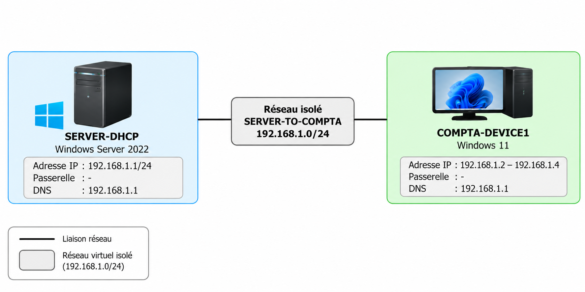
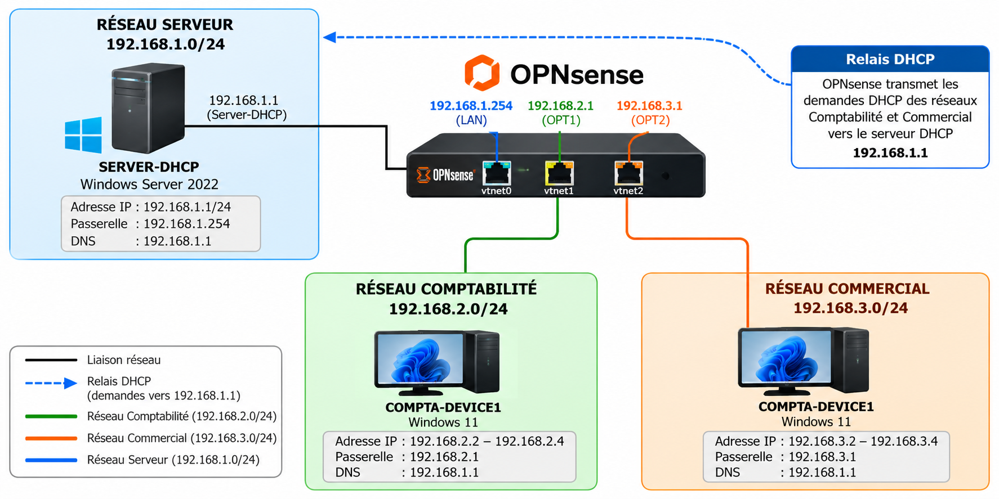

# Lab de virtualisation KVM : serveur DHCP et poste comptabilité

| Linux | Virtualisation (KVM) | Machines virtuelles | Réseau (IP, DHCP) |
|:---:|:---:|:---:|:---:|
| 🟦⬜⬜⬜ | 🟦⬜⬜⬜ | 🟦⬜⬜⬜ | 🟦🟦⬜⬜ |

Échelle : 🟦⬜⬜⬜ Découverte · 🟦🟦⬜⬜ Apprentissage · 🟦🟦🟦⬜ Pratique · 🟦🟦🟦🟦 Maîtrise

## Un projet de découverte 

Ce projet représente ma toute première expérience technique dans le domaine des systèmes et réseaux.

Ce que je connaissais avant :
- Linux : je connaissais le nom, mais je ne l'avais jamais utilisé.
- Installation d'un système : j'avais déjà installé Windows plusieurs
  fois depuis une clé USB, mais jamais Linux.
- Réseau (IP, DNS, DHCP, étendue..) : je connaissais ces termes de nom, grâce
  aux jeux vidéo, sans savoir concrètement comment ils fonctionnent.

Ce que je découvre avec ce projet :
- Linux, installé depuis une clé USB
- KVM et la virtualisation
- Les ISO et les VM
- Le fonctionnement concret d'un réseau (DHCP, adresses IP..)

J'apprends en m'appuyant sur des ressources en ligne, notamment la documentation disponible sur GitHub et Reddit, 
ainsi que des tutoriels sur YouTube.

## Objectif du projet

Installer Linux sur un PC, découvrir la virtualisation avec **KVM et Virt-Manager**, puis créer un petit réseau d'entreprise autour d'un serveur DHCP Windows.

Le projet a évolué en deux étapes :

1. **Créer un premier réseau fonctionnel**, composé d'un serveur DHCP Windows Server 2022 et d'un client Windows 11.
2. **Faire évoluer ce réseau** en ajoutant un routeur OPNsense, deux réseaux clients distincts et un relais DHCP.

L'objectif final est de permettre à un seul serveur DHCP de distribuer des adresses IP à des postes situés sur plusieurs sous-réseaux.

## 1. Première architecture : un réseau isolé

Au départ, mon infrastructure était composée de deux VM :

| VM | Système | Rôle |
|---|---|---|
| SERVER-DHCP | Windows Server 2022 | Serveur DHCP |
| COMPTA-DEVICE1 | Windows 11 | Poste client |

Les deux VM étaient connectées au même réseau virtuel isolé sous KVM.

Le serveur DHCP disposait de l'adresse fixe `192.168.1.1` et distribuait les adresses de `192.168.1.2` à `192.168.1.4`.

Cette première étape m'a notamment permis de comprendre le fonctionnement du DHCP et de résoudre un problème lié au service DHCP intégré au réseau par défaut de libvirt.

Après correction, le client recevait bien une adresse depuis mon serveur Windows.

## 2. Évolution : OPNsense et relais DHCP

Une fois le premier réseau fonctionnel, j'ai voulu aller plus loin :

**Comment permettre à un serveur DHCP de distribuer des adresses à des postes situés sur des réseaux différents ?**

J'ai donc ajouté une troisième VM, **ROUTAGE**, fonctionnant sous OPNsense.

### Machines virtuelles utilisées

| VM | Système | Rôle |
|---|---|---|
| SERVER-DHCP | Windows Server 2022 | Serveur DHCP et DNS |
| ROUTAGE | OPNsense | Routeur et relais DHCP |
| COMPTA-DEVICE1 | Windows 11 | Client utilisé pour les tests |

**L'infrastructure utilise trois VM au total.**

En raison des 8 Go de RAM de mon PC hôte, je n'ai pas créé un deuxième client Windows 11. J'ai réutilisé **COMPTA-DEVICE1**, en le connectant successivement aux réseaux Comptabilité et Commercial.

### Réseaux configurés

| Réseau | Sous-réseau | Passerelle |
|---|---|---|
| Serveur | `192.168.1.0/24` | `192.168.1.254` |
| Comptabilité | `192.168.2.0/24` | `192.168.2.1` |
| Commercial | `192.168.3.0/24` | `192.168.3.1` |

Le serveur DHCP Windows conserve son adresse `192.168.1.1`.

OPNsense dispose de trois interfaces réseau, une pour chaque sous-réseau.

### Architecture finale

Le relais DHCP d'OPNsense transmet les demandes provenant des réseaux Comptabilité et Commercial vers le serveur Windows situé sur le réseau Serveur.

Deux étendues DHCP ont été configurées :

| Étendue | Plage DHCP | Passerelle | DNS |
|---|---|---|---|
| Comptabilité | `192.168.2.2` à `192.168.2.4` | `192.168.2.1` | `192.168.1.1` |
| Commercial | `192.168.3.2` à `192.168.3.4` | `192.168.3.1` | `192.168.1.1` |

## 3. Tests et résultats

Les tests ont été réalisés depuis la VM Windows 11 **COMPTA-DEVICE1**.

### Test sur le réseau Comptabilité

Après raccordement du client au réseau Comptabilité et renouvellement de son adresse IP :

- **Adresse obtenue :** `192.168.2.2`
- **Passerelle :** `192.168.2.1`
- **Serveur DHCP :** `192.168.1.1`
- **DNS :** `192.168.1.1`

**Résultat : attribution DHCP réussie.**

### Test sur le réseau Commercial

La même VM a ensuite été raccordée au réseau Commercial.

- **Adresse obtenue :** `192.168.3.2`
- **Passerelle :** `192.168.3.1`
- **Serveur DHCP :** `192.168.1.1`
- **DNS :** `192.168.1.1`

**Résultat : attribution DHCP réussie.**

Ces deux tests confirment que le relais DHCP permet au serveur Windows de distribuer des adresses sur les deux réseaux clients.

### Problème rencontré

Lors du premier test sur le réseau Comptabilité, le client obtenait une adresse APIPA (`169.254.x.x`) au lieu d'une adresse DHCP.

Après vérification des réseaux virtuels, des étendues Windows et de la configuration d'OPNsense, j'ai identifié le problème : **les relais DHCP étaient configurés, mais pas activés**.

Leur activation a permis de résoudre le problème.

## 4. Documentation du projet

J'ai documenté les différentes étapes de mon homelab, de l'installation de KVM jusqu'aux tests du relais DHCP.

| Chapitre | Contenu |
|---|---|
| [01 - Installation de KVM](HOMELAB/01-Installation-kvm.md) | Installation et découverte de KVM et Virt-Manager |
| [02 - Création des VM](HOMELAB/02-Creation-vm.md) | Création du serveur Windows et du premier client |
| [03 - Configuration DHCP](HOMELAB/03-Configuration-dhcp.md) | Configuration du serveur DHCP Windows |
| [04 - Configuration réseau](HOMELAB/04-Configuration-reseau.md) | Réseau isolé KVM et correction du conflit DHCP |
| [05 - Tests et validation](HOMELAB/05-Tests-validation.md) | Vérification du fonctionnement du premier réseau |
| [06 - OPNsense et relais DHCP](HOMELAB/06-OPNsense-routage-relais-dhcp.md) | Routage, nouveaux sous-réseaux, relais DHCP et tests |

Chaque chapitre présente la configuration réalisée, les difficultés rencontrées et les résultats obtenus, avec des captures d'écran.

## 5. État du projet

*Dernière mise à jour : 23/10/2026*

- [x] Installation de Linux sur le PC
- [x] Installation de KVM et Virt-Manager
- [x] Création des VM Windows Server 2022 et Windows 11
- [x] Configuration du premier serveur DHCP
- [x] Création d'un réseau virtuel isolé
- [x] Validation de l'attribution DHCP sur le premier réseau
- [x] Installation et configuration d'OPNsense
- [x] Mise en place des trois sous-réseaux
- [x] Création des étendues DHCP Comptabilité et Commercial
- [x] Configuration et activation du relais DHCP
- [x] Test DHCP réussi sur le réseau Comptabilité
- [x] Test DHCP réussi sur le réseau Commercial
- [x] Documentation des étapes sur GitHub

**Statut : projet terminé pour les objectifs définis.**

## 6. Bilan

Ce premier homelab m'a permis de passer de la découverte de Linux et de la virtualisation à la configuration d'une petite infrastructure réseau fonctionnelle.

J'ai notamment découvert :

- L'installation et l'utilisation de Debian.
- La création et la gestion de VM avec KVM et Virt-Manager.
- La configuration d'un serveur DHCP sous Windows Server.
- La création de réseaux virtuels isolés.
- L'utilisation d'un routeur OPNsense avec plusieurs interfaces.
- Le fonctionnement d'un relais DHCP entre plusieurs sous-réseaux.
- La recherche de pannes à partir des résultats obtenus sur les VM.

Le point le plus important pour moi a été de comprendre progressivement **pourquoi une configuration fonctionnait ou ne fonctionnait pas**, plutôt que de simplement reproduire des étapes.

Ce dépôt retrace donc à la fois le résultat final et mon apprentissage, avec les erreurs et les corrections qui ont accompagné le projet.

Le routage et le relais DHCP sont désormais fonctionnels. La sécurisation des échanges entre les réseaux pourra faire l'objet d'un autre projet.
